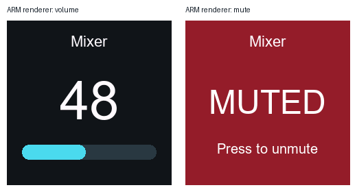

# Experimental D-NVC2 display firmware — revision 2

This optional firmware changes the physical knob's volume and mute screens. It is separate from the Companion module and is not an official RDL release. The module does not require it.

## Download

Download the tested HEX and `SHA256SUMS.txt` from the [firmware prerelease](https://github.com/ukiews/companion-module-rdl-nvc2/releases/tag/firmware-ui-0.1.30-r2). The HEX is based on the specific RDL D-NVC2 0.1.30 image identified below. Other firmware versions, models, and bootloaders have not been validated.



## Display changes

- Large 1–100 indication and cyan level bar on a dark background.
- Dynamic name of the active saved Config profile.
- Full red mute screen with **MUTED** and a centered **Press to unmute** hint.
- Revision 2 increases the hint font from 15 to 20 pixels and the bar height from 13 to 22 pixels.
- No speaker icon, minus sign, dB label, `/100`, or channel footer.

The 1–100 indication maps the existing 64 non-muted attenuation values. It does not change the audio gain curve or add hardware gain steps. The five stock menu themes remain present. The new volume and mute views deliberately keep their fixed dark/cyan and red colors regardless of menu theme selection.

## Validation and limitations

Revision 2 was installed on one D-NVC2 running the legacy H743 bootloader 0.1.5. The complete application partition hash matched. Live control checks passed for all five themes, all four saved Config profiles, volume, mute/unmute, and restored settings. The original design's physical volume and mute views were confirmed by the owner; revision 2's readability changes have automated renderer and live control validation.

Offline checks include 93 renderer cases, 25 theme checks, 19 updater/recovery simulations, and four cases executing the actual vendor SPI HAL with simulated hardware registers. Observed stack usage in the latter was 420 bytes against the 1,024-byte display-thread stack; caller and interrupt context are additional.

Only two four-byte display hooks and a new renderer/font payload differ from the vendor image. The vector table, audio/network code, and bootloader are unchanged. Testing on one unit does not establish compatibility with other hardware revisions or long-term reliability.

## Installation and recovery

The tested installation used a purpose-built legacy H743 uploader with a verified stock backup and complete image-hash verification. **A portable installer is not included in this release.** The tested Console 3 version's stock update path had incompatible H743 partition/protocol handling; selecting this HEX in that updater is not a validated installation procedure. Do not enable **Bootloader Update** for this UI patch.

Keep the original vendor firmware and establish a recovery procedure for your exact hardware before attempting installation. A verified backup can be restored while the bootloader is reachable, but software rollback cannot guarantee recovery from an application crash that prevents network access. Physical recovery after such a crash was not established in this project.

The underlying 0.1.30 firmware reports its model as `UNKOWN` on the tested unit, which can prevent Console from loading its normal settings. This UI patch does not change that behavior. A device-specific local Console workaround was used during testing; it is not a general firmware fix or included here.

## Build the UI patch

The UI patch source and build scripts are included in this directory. They do not contain RDL's original source, protocol documents, or the vendor input HEX.

Requirements: Python with Pillow, Arm GNU Toolchain 15.2.1 for the reference build, and a locally available Arial TrueType font. Font bitmaps are generated locally; no TTF font file is included. A different compiler or font may produce a different binary. Set `ARM_GNU_BIN` to the toolchain's `bin` directory if it is not on PATH, and `RDL_UI_FONT` to your font path if needed.

```sh
python -m pip install Pillow
python firmware-ui/build.py /path/to/D-NVC2-1.30-O1.hex
```

The script requires this exact vendor input SHA-256:

```text
2fa234e1e2257d91fff0c6e293728243f37368e0c624d39b62ec2d799ee131cb
```

Outputs are written under `firmware-ui/dist/`. The script validates input records, allowed changed regions, vector invariance, output HEX checksums, and the complete partition image. It never contacts a device. Successful compilation is not hardware validation of a newly generated image.

## Reference release identity

```text
Patched HEX SHA-256:
5592c62fdcd43252f17770d1fd96eebfc692747efd546e6f0d71133060fd5619

Patched full-partition FNV-1a-64: e16ad1f6e5940d96
Stock full-partition FNV-1a-64:   cc4e21c390e3bf1b
Application partition:          0x08060000–0x080bffff
```

The new UI source is covered by the repository's MIT license. The downloadable HEX also contains RDL firmware; the repository's MIT license does not relicense RDL's code or third-party font material. RDL and Bitfocus have not endorsed this modification.
